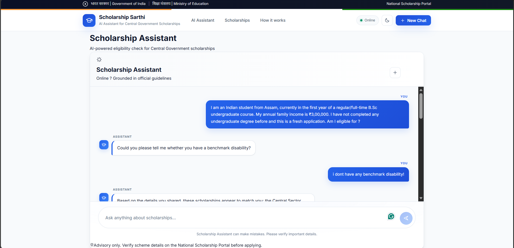
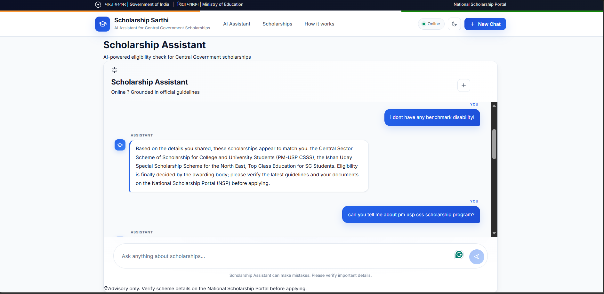
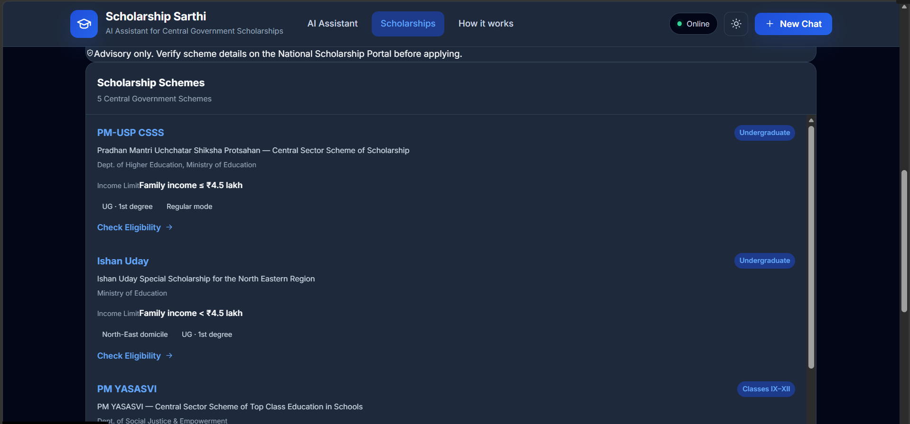
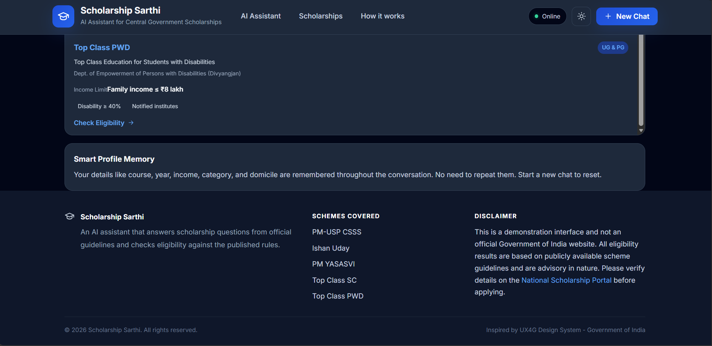
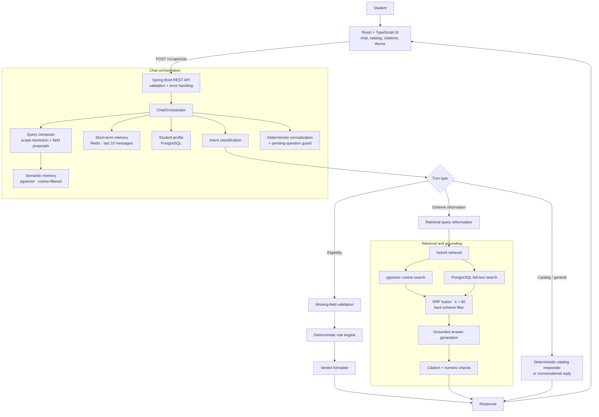
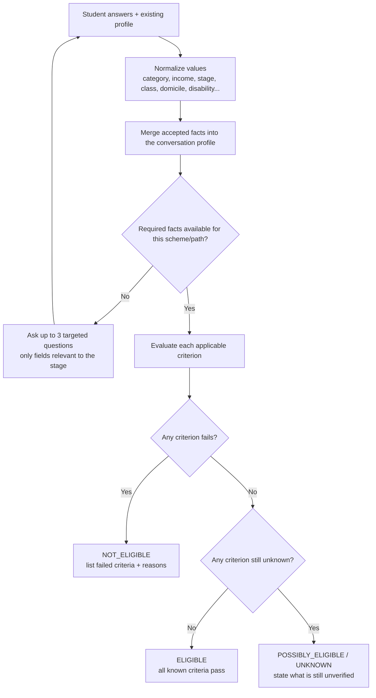
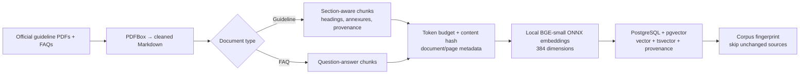
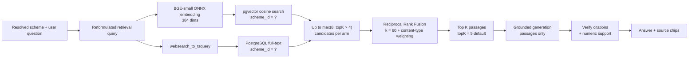

<div align="center">

# 🎓 Scholarship Sarthi

### AI scholarship assistant for India — deterministic eligibility, grounded answers, no hallucinated verdicts.

Check eligibility for five Central Government scholarship schemes and ask questions answered from official guidelines, with citations. Built with **Spring Boot**, **LangChain4j**, **pgvector hybrid search (RAG)**, **Redis**, and **React + TypeScript**.

[Features](#-features) · [How it works](#-how-it-works) · [Quick start](#-quick-start) · [API](#-api-reference) · [Limitations](#-limitations) · [Roadmap](#-roadmap)


</div>

> [!IMPORTANT]
> Scholarship Sarthi is an **informational assistant**, not an awarding authority. Eligibility results are advisory. Always verify current rules, deadlines, and application status in the official scheme guidelines and on the [National Scholarship Portal](https://scholarships.gov.in/).

---

## 📑 Table of contents

- [Overview](#-overview)
- [The real-world problem](#-the-real-world-problem)
- [How Scholarship Sarthi solves it](#-how-scholarship-sarthi-solves-it)
- [Supported schemes](#-supported-schemes)
- [Features](#-features)
- [Interface preview](#-interface-preview)
- [How it works](#-how-it-works)
- [Tech stack](#-tech-stack)
- [Project structure](#-project-structure)
- [Quick start](#-quick-start)
- [Knowledge ingestion](#-knowledge-ingestion)
- [API reference](#-api-reference)
- [Testing](#-testing)
- [Design decisions](#-design-decisions)
- [Limitations](#-limitations)
- [Roadmap](#-roadmap)
- [Security notes](#-security-notes)
- [Contributing](#-contributing)
- [License](#-license)

---

## ✨ Overview

Scholarship rules are scattered across guidelines, FAQs, eligibility conditions, and application instructions. A fluent answer isn't enough when a wrong income limit or a wrong eligibility verdict can mislead a student.

Scholarship Sarthi keeps two paths deliberately separate:

| Path | What it does | Who decides |
|---|---|---|
| **Eligibility assessment** | Evaluates normalized student-profile facts against structured scheme criteria | A **deterministic rule engine** |
| **Scheme Q&A** | Retrieves relevant passages from the scheme corpus and writes a cited explanation | **Retrieval + grounded LLM**, with citation and numeric checks |

> The language model interprets questions and explains evidence. **It never chooses `ELIGIBLE` or `NOT_ELIGIBLE`.**

### At a glance

| | |
|---|---|
| **Schemes covered** | 5 Central Government schemes |
| **Retrieval** | Hybrid: pgvector cosine similarity + PostgreSQL full-text, fused with RRF (`k = 60`) |
| **Embeddings** | Local `bge-small-en-v1.5` (ONNX, 384 dimensions), no external embedding API |
| **Scheme isolation** | Hard SQL filter, so evidence from one scheme can't leak into another's answer |
| **LLM providers** | Groq → Gemini → OpenRouter fallback chain |
| **Memory** | Redis (short-term) + pgvector (semantic) + PostgreSQL student profile |
| **Frontend** | React + TypeScript, responsive, light/dark, keyboard-friendly |
| **Verdict source** | `EligibilityEngine` — deterministic code, not a prompt |

---

## 🌍 The real-world problem

A student from Assam, in the first year of a regular B.Sc., with a family income of ₹3 lakh, does not need a generic essay about scholarships. They need to know **which schemes they may qualify for, why, what evidence supports that, and what is still unknown**.

That is surprisingly hard to answer safely:

| Real-world difficulty | Why it hurts students | What a naive chatbot does |
|---|---|---|
| **Rules live in many places** | Guidelines, FAQs, annexures, and portal pages disagree or repeat each other | Picks one plausible passage and presents it as the whole truth |
| **Eligibility is conditional** | Income may be “up to” vs. “below” a limit; class ranges, domicile, disability, fresh/renewal, regular mode, and prior-degree rules all interact | Confuses an exception with the default rule |
| **Schemes overlap** | A student may match several schemes for different reasons | Gives one verdict, or silently mixes criteria from different schemes |
| **Wrong facts are expensive** | A wrong ceiling, deadline, or verdict can send a student to the wrong application path | Invents a number or date that sounds convincing |
| **The student must be guided** | Essential facts are often missing at the first message | Asks for everything at once, or guesses the missing values |
| **Conversation matters** | Students ask follow-ups like “What about the income limit?” | Forgets context, or lets an old message override the current question |
| **Services fail** | Embedding, database, Redis, or LLM providers can be unavailable | Says “no information found” when it actually failed to search |

### Who this is for

- Students comparing Central Government scholarships before applying.
- First-generation applicants who do not know which scheme fits them.
- Students checking a specific condition such as domicile, income, disability, or first-year status.
- Anyone who wants a cited explanation rather than a confident-sounding guess.

### What it deliberately does not do

- It does **not** submit applications.
- It does **not** award scholarships or replace the National Scholarship Portal.
- It does **not** claim that a verdict is final.
- It does **not** let the language model decide eligibility.
- It does **not** claim to model every scheme-specific rule yet (see [Limitations](#-limitations)).

---

## 🛠️ How Scholarship Sarthi solves it

The design is not “put PDFs in a vector database and ask an LLM.” Each real-world failure has a specific mechanism behind it.

| Problem | Scholarship Sarthi mechanism | Why it works |
|---|---|---|
| **Hallucinated verdicts** | Eligibility is computed by `EligibilityEngine` against `SchemeEligibilityCatalog` | Same profile + same rules = same verdict, every time. Auditable and testable |
| **Wrong or invented numbers** | Answers must cite passage numbers; every number in the answer must appear in a cited passage | Unsupported numeric claims are rejected, not smoothed over |
| **Scheme contamination** | Resolved scheme is enforced as a hard `scheme_id` SQL filter, not a ranking hint | Evidence from scheme A can never be stated as scheme B's rule |
| **Generic policy answers** | Hybrid retrieval combines semantic similarity with exact-token search | Vector catches paraphrases; full-text preserves names, class ranges, amounts, dates |
| **Asking for everything** | Validation engine asks only fields relevant to the education stage and requested scheme; up to three missing fields at a time | Keeps the conversation short and purposeful |
| **Trusting the student incorrectly** | Extracted profile values are proposals, accepted only when self-describing or answering the pending question, then normalized | A question *about* a category does not silently become the student's *own* category |
| **Repeating details** | Redis holds recent turns; PostgreSQL stores the structured profile; pgvector holds semantic memory | Follow-ups work without making students re-enter facts |
| **Losing the current question** | Intent classification uses the raw query; context is added only after classification | An explicit new question outranks stale history |
| **Silent search failure** | A failed retrieval arm is tracked separately from an empty result; both arms failing raises an unavailability response | “Search failed” is never reported as “the documents say nothing” |
| **Provider outage** | Groq → Gemini → OpenRouter fallback chain; local embeddings | A single provider is not a single point of failure |
| **Unreadable evidence** | Every passage carries document and page provenance; the UI can show source chips | A student can check the official source instead of trusting the prose |

### Example journey

1. A student writes: *“I am an Indian student from Assam, in the first year of a regular B.Sc. My family income is ₹3,00,000. I have not completed an undergraduate degree and this is a fresh application. Which schemes may I qualify for?”*
2. The composer proposes profile values; deterministic normalization decides what may be stored. The validator notices that one relevant fact is still missing and asks only that question — for example, whether the student has a benchmark disability.
3. After the answer, the rule engine evaluates the applicable schemes. The result is a deterministic verdict per scheme, with failing or unknown criteria listed.
4. The student follows up: *“Can you tell me about the PM-USP CSSS scheme?”* The scheme is resolved explicitly, retrieval is restricted to that scheme's corpus, and the explanation cites the guideline passages.
5. The answer ends with an advisory to verify on the National Scholarship Portal. The app never pretends to be the awarding authority.

### Implemented eligibility rules (snapshot)

These are the rules transcribed into [`SchemeEligibilityCatalog.java`](backend/src/main/java/com/bharat/scholarship_rag_backend/eligibility/SchemeEligibilityCatalog.java). Each rule carries its source location from the official documents.

| Scheme | Category | Income ceiling | Stage / class | Domicile | Disability | Fresh award limited to first year | Regular mode required | Prior degree blocks |
|---|---|---|---|---|---|---|---|---|
| **PM-USP CSSS** | Any (reservation internal) | ≤ ₹4.5 lakh | UG / PG | — | — | Yes | Yes | No |
| **Ishan Uday** | Any | < ₹4.5 lakh | UG | 8 North-Eastern states | — | Yes | Yes | Yes |
| **PM YASASVI Top Class Schools** | OBC / EBC / DNT | < ₹2.5 lakh | Classes 9–12 | — | — | No | — | No |
| **Top Class SC** | SC | ≤ ₹8 lakh | UG / PG | — | — | Yes | Yes | No |
| **Top Class PWD** | Any | ≤ ₹8 lakh | UG / PG | — | ≥ 40% benchmark disability | No | — | No |

> The table is a developer-facing snapshot of what the engine currently implements. It is not an official eligibility checklist. The documents themselves remain the authority.

---

## 🧭 Supported schemes

| Scheme | Intended audience (high-level) | Code |
|---|---|---|
| PM-USP CSSS | Eligible college and university students | `PM_USP_CSSS` |
| Ishan Uday | Eligible undergraduate students from the North Eastern Region | `ISHAN_UDAY` |
| PM YASASVI Top Class Schools | Eligible OBC, EBC, and DNT students in classes 9–12 | `PM_YASASVI_TOP_CLASS_SCHOOLS` |
| Top Class Education for SC Students | Eligible SC students in higher education | `TOP_CLASS_SC` |
| Top Class Education for Students with Disabilities | Eligible students with benchmark disabilities in higher education | `TOP_CLASS_PWD` |

These are short descriptions, not complete eligibility checklists. Exact conditions depend on each scheme's current official guidelines and the criteria implemented in the application.

---

## 🚀 Features

<details open>
<summary><strong>Student experience</strong></summary>

- Natural-language questions about scheme rules and eligibility
- Guided profile collection when essential information is missing
- Eligibility screening for one scheme, or discovery across the whole catalog
- Follow-up questions that use recent conversation context
- Scheme cards with prefilled eligibility prompts
- Citation-aware answers with source chips
- Retry and connection-status states for backend failures
- Light/dark theme, responsive layout, keyboard-friendly controls, reduced-motion support
- Conversation ID and transcript persisted in browser `localStorage`

</details>

<details>
<summary><strong>Reliability and correctness</strong></summary>

- Deterministic eligibility verdicts, never LLM-generated
- Hard SQL scheme filters to prevent cross-scheme evidence leakage
- Hybrid retrieval (vector + full-text) combined with Reciprocal Rank Fusion
- Source provenance on every chunk: document and page information
- Grounding checks reject unsupported passage references and unsupported numeric claims
- “Retrieval failed” is distinguished from “search succeeded but found nothing relevant”
- Redis and semantic-memory failures degrade gracefully
- Provider fallback chain: Groq → Gemini → OpenRouter

</details>

<details>
<summary><strong>Knowledge ingestion</strong></summary>

- PDF-to-cleaned-Markdown utility
- Section-aware chunking for guidelines; question-answer chunking for FAQs
- Token-budget checks, content hashes, provenance metadata, and a reviewable chunk dump
- Local BGE embeddings via ONNX Runtime
- Optional ingestion into PostgreSQL/pgvector
- Corpus fingerprinting to skip unchanged source documents

</details>

---

## 🖥️ Interface preview

The screenshots below are from the running application. The assistant asks only for the missing fact, then returns a cited result; the scheme catalog is browsable independently.

<p align="center">
  
  
</p>

<p align="center">
  <sub><strong>Left:</strong> A guided eligibility check. The assistant has already extracted the student's course, year, income, domicile, and fresh-application status, and asks only about benchmark disability. <strong>Right:</strong> The result lists schemes that appear to match, with an advisory to verify on the National Scholarship Portal.</sub>
</p>

<p align="center">
  
  
</p>

<p align="center">
  <sub><strong>Left:</strong> Scheme discovery with high-level conditions and prefilled “Check Eligibility” actions. <strong>Right:</strong> The catalog explains that course, year, income, category, and domicile are remembered for the conversation, and shows the advisory disclaimer.</sub>
</p>

> Screenshots are stored under [`docs/images/`](docs/images/) and render directly on GitHub. Add more under the same folder and reference them with relative paths.

---

## 🏗️ How it works

### Architecture principles

1. **Separate decision from explanation.** The rule engine decides eligibility; the LLM only explains retrieved evidence.
2. **Scope before search.** Resolve the scheme first, then retrieve with a hard filter.
3. **Prefer evidence over fluency.** Answers are validated for citations and numeric support.
4. **Fail explicitly.** A failed search must not look like an empty corpus.
5. **Treat memory as context, not authority.** Explicit current questions and named schemes win.
6. **Keep the costly parts local where possible.** Embeddings run on-device via ONNX; only generation calls an external provider.

### System architecture



### Request lifecycle

| Step | Component | What happens |
|---|---|---|
| 1 | `ChatController` | Validates `conversationId` and `query`; rejects malformed requests with `400` |
| 2 | `ConversationMemory` | Loads the last 10 messages from Redis for the conversation |
| 3 | `QueryGate` | Cleans the raw query without destroying the user's intent |
| 4 | `SchemeCatalogResponder` | Answers catalog meta-questions deterministically before any model call |
| 5 | `IntentClassification` | Routes the turn: scholarship, catalog, general chat, or unknown |
| 6 | `QueryEnricher` | Adds recent context only when the query needs it |
| 7 | `QueryComposer` | Resolves schemes and proposes profile values from the composed query |
| 8 | `PendingAnswerResolver` + `ProfileValueNormalizer` | Accepts only context-appropriate values and normalizes them |
| 9 | `ValidationEngine` | Checks whether required facts are available; asks for up to three missing fields |
| 10 | `EligibilityEngine` | Evaluates criteria deterministically when validation is ready |
| 11 | `RetrievalQueryReformulator` | Builds a retrieval-focused query for informational turns |
| 12 | `ScholarshipRetrieval` | Runs vector + full-text arms, fuses rankings, applies the scheme filter |
| 13 | `ScholarshipAnswerGenerator` | Generates a cited answer from numbered passages, then validates grounding |
| 14 | `ChatOrchestrator` | Returns the response and updates conversation/memory state |

### Eligibility: rules first, language model second

Eligibility checks can influence a student's decisions, so the verdict is computed by the rule engine, not written by an LLM.



The rule catalog covers social category, family income, education stage, class/year, domicile, disability, nationality, fresh vs. renewal status, first-year restrictions, regular study mode, and prior-degree restrictions. Not every scheme-specific requirement is modelled yet; see [Limitations](#-limitations).

#### Why the verdicts are trustworthy

| Guarantee | Mechanism |
|---|---|
| The LLM cannot emit a verdict | `EligibilityEngine` returns `ELIGIBLE`, `POSSIBLY_ELIGIBLE`, `NOT_ELIGIBLE`, or `UNKNOWN` |
| Threshold semantics are explicit | The catalog distinguishes “up to” (inclusive) from “below” (exclusive) ceilings |
| Missing data is not guessed | Unknown criteria produce `POSSIBLY_ELIGIBLE`/`UNKNOWN`, not a false positive |
| Rules are testable | Criteria are Java data, not prose inside a prompt |
| Rules are traceable | Each scheme's criteria carry source references into the cleaned Markdown |

#### Profile-poisoning guards

Model-extracted values are treated as proposals, not facts. They're accepted only when:

- the user is describing themselves, or
- the user is answering a field that was just requested,

and only after normalization and plausibility checks. A question about scholarships *for* a category must not silently become the student's *own* category. The pending-question state and deterministic fallbacks prevent a field from getting stuck or being overwritten by an unrelated turn.

### Knowledge ingestion



| Stage | Implementation |
|---|---|
| Source corpus | Official scheme guideline PDFs and available FAQs, converted to cleaned Markdown |
| Chunking | Section-aware guideline chunks; FAQ question-answer chunks |
| Embeddings | Local `bge-small-en-v1.5` ONNX model, 384 dimensions |
| Vector search | PostgreSQL + pgvector cosine distance |
| Keyword search | PostgreSQL full-text search with `websearch_to_tsquery` |
| Fusion | Reciprocal Rank Fusion, `k = 60` |
| Default result count | `topK = 5` |
| Scope | Resolved scheme enforced as a hard SQL filter |
| Grounding | Numbered passages with provenance; checks for valid citations and numeric support |

### Retrieval and grounded answers



With the default `topK = 5`, each retrieval arm considers up to `max(8, topK × 4)` candidates before fusion. Guideline passages carry a higher content-type weight than FAQ restatements and portal pages.

The model is instructed to use only the supplied passages, prefer normative guideline text, cite factual claims, and never invent rules, amounts, or dates. Deterministic checks validate citation references and numeric support. These checks improve reliability but **do not prove all semantic entailment**.

#### Why hybrid retrieval instead of vector-only search

| Query type | Vector arm | Full-text arm |
|---|---|---|
| Paraphrase: “Can more than two siblings get it?” | Finds the passage about sibling limits | May miss the exact wording |
| Exact term: “Class IX–XII”, “₹2.5 lakh”, “UDID” | May blur the token | Preserves the exact token |
| Scheme name | Understands the topic | Locks onto the literal name |
| Numbers and dates | Weak on exact values | Strong on exact values |

RRF is used instead of adding normalized scores because `ts_rank` and cosine distance live on unrelated scales. RRF reads only rank positions, so it needs no weight tuning and automatically promotes a chunk that both arms like.

### Memory model

| Layer | Storage | Role |
|---|---|---|
| Short-term | Redis (configurable TTL) | Last 10 messages read for context |
| Long-term semantic | PostgreSQL + pgvector | Embedded conversation context, retrieved within the conversation boundary and filtered by cosine distance |
| Student profile | PostgreSQL | Structured facts tied to a conversation |
| Browser state | `localStorage` | Active conversation ID, transcript, and theme |

Memory is context, not authority: a self-contained current question and an explicitly named scheme take precedence over older conversation context.

### Failure behaviour

| Failure | System behaviour |
|---|---|
| Redis unavailable | Conversation history is empty; the turn still runs |
| Semantic memory unavailable | No semantic context; eligibility and keyword retrieval still run |
| Vector arm fails | Full-text arm still returns results |
| Full-text arm fails | Vector arm still returns results |
| Both retrieval arms fail | Explicit temporary-unavailability response — never “the documents don't contain this” |
| Search succeeds but finds nothing | An honest “not found in the provided guidelines” response |
| Answer generation fails | Temporary-unavailability response, not a fabricated answer |
| Grounding check fails | The answer is rejected; the user is asked to rephrase or narrow the scope |
| Primary LLM fails | Groq → Gemini → OpenRouter fallback chain |
| Invalid request | `400` with validation details |
| Unexpected server error | `500` through the global exception handler |

### Why the architecture is unusually strong

| Strength | How it shows up |
|---|---|
| **Deterministic core** | The highest-stakes output — eligibility — is pure code with explicit thresholds and tests |
| **Evidence-bound language** | Every factual claim should be traceable to a numbered passage; numbers are checked against the cited passages |
| **Hard isolation** | The scheme filter is in SQL, so it cannot be “prompted around” |
| **Two independent retrieval signals** | Semantic recall and lexical precision cover each other's blind spots |
| **Graceful degradation** | Redis, semantic memory, retrieval arms, and LLM providers all have defined failure paths |
| **Local embeddings** | No embedding API bill, no embedding-provider outage, no document text sent out for embedding |
| **Modular boundaries** | `eligibility`, `retrieval`, `composer`, `validator`, `memory`, `catalog`, and `orchestration` are separately testable packages |
| **Auditability** | Rules cite their source locations; answers carry document/page provenance |
| **Clear authority boundary** | The UI and the prompts both state that results are advisory and the portal is authoritative |

---

## 🧰 Tech stack

| Layer | Technologies |
|---|---|
| Backend | Java 21, Spring Boot 4.1.1, Spring Web MVC |
| Persistence | Spring Data JPA, Hibernate, PostgreSQL |
| Retrieval | pgvector, PostgreSQL full-text search, Reciprocal Rank Fusion |
| Short-term memory | Spring Data Redis |
| AI orchestration | LangChain4j 1.16.1, Spring AI BOM 2.0.1 |
| LLM providers | Groq, Google Gemini, OpenRouter (OpenAI-compatible APIs) |
| Embeddings | BGE Small English v1.5, ONNX, 384 dimensions |
| Document processing | Apache PDFBox 3.0.8 |
| Frontend | React 18.3.1, TypeScript 5.6.3, Vite 6 |
| Quality | JUnit 5, Spring Boot Test, TypeScript checks, Vite production build |

---

## 📁 Project structure

```text
scholarship-sarthi/
├── backend/
│   ├── src/main/java/com/bharat/scholarship_rag_backend/
│   │   ├── catalog/          # Deterministic catalog answers
│   │   ├── chunking/         # Chunking and ingestion
│   │   ├── composer/         # Query composition and profile extraction
│   │   ├── config/           # LLM fallback, Redis, vector index setup
│   │   ├── controller/       # REST endpoints
│   │   ├── dto/              # Request/response contracts
│   │   ├── eligibility/      # Deterministic validation and rules
│   │   ├── embedding/        # Local query embeddings
│   │   ├── enrichment/       # Query cleaning and context enrichment
│   │   ├── entity/           # JPA entities and enums
│   │   ├── exception/        # Global error handling
│   │   ├── extraction/       # PDF-to-Markdown conversion
│   │   ├── intent/           # Intent classification
│   │   ├── memory/           # Redis and semantic memory
│   │   ├── normalization/    # Profile value normalization
│   │   ├── orchestration/    # Main chat flow
│   │   ├── repository/       # Vector, full-text, profile, memory queries
│   │   ├── retrieval/        # Hybrid retrieval and grounded answers
│   │   ├── scheme/           # Scheme registry and metadata
│   │   ├── service/          # Student profile service
│   │   └── validator/        # Missing-field and pending-question state
│   └── src/main/resources/
│       ├── scholarships/     # Source PDFs
│       └── cleaned-markdown/ # Retrieval corpus
├── docs/
│   └── images/               # README screenshots (rendered on GitHub)
└── frontend/
    └── src/
        ├── components/
        ├── pages/
        ├── data/
        └── lib/
```

### Implementation map

| Concern | Main classes |
|---|---|
| Chat entry point | `ChatController`, `GlobalExceptionHandler` |
| Turn routing | `ChatOrchestrator`, `IntentClassification`, `QueryGate`, `QueryEnricher` |
| Eligibility | `ValidationEngine`, `EligibilityEngine`, `SchemeEligibilityCatalog`, `EligibilityAnswerFormatter` |
| Profile safety | `QueryComposer`, `PendingAnswerResolver`, `ProfileValueNormalizer`, `StudentProfileService` |
| Retrieval | `RetrievalQueryReformulator`, `ScholarshipRetrieval`, `ScholarshipChunkRepo` |
| Grounded generation | `ScholarshipAnswerGenerator` |
| Memory | `ConversationMemory`, `SemanticMemoryManager` |
| Ingestion | `CorpusChunker`, `GuidelineChunker`, `FaqChunker`, `ChunkIngestionRunner` |
| Provider resilience | `FallbackChatModel`, `FallbackStreamingChatModel`, `LlmConfig` |

---

## ⚡ Quick start

### Prerequisites

- Java 21 JDK
- Node.js and npm
- PostgreSQL with the `pgvector` extension
- Redis
- Git (the Maven Wrapper is included in `backend/`)

> [!WARNING]
> **Database schema:** a standalone SQL migration for the `scholarship_chunks` vector/full-text schema is not included yet. A fresh database may need the vector and `tsvector` columns and indexes created manually before ingestion. Don't assume `ddl-auto=update` can create every pgvector-specific object. Versioned migrations are on the [roadmap](#-roadmap).

### 1. Clone

```bash
git clone https://github.com/Bharatmarwah/Scholarship-saathi.git
cd Scholarship-saathi
```

### 2. Start PostgreSQL (pgvector) and Redis

Any local installation works. If you prefer Docker for the dependencies:

```bash
docker run -d --name sarthi-pg -p 5432:5432 \
  -e POSTGRES_DB=scholarship_sarthi \
  -e POSTGRES_USER=postgres \
  -e POSTGRES_PASSWORD=postgres \
  pgvector/pgvector:pg16

docker run -d --name sarthi-redis -p 6379:6379 redis:7
```

Enable the extension:

```sql
CREATE EXTENSION IF NOT EXISTS vector;
```

### 3. Configure environment variables

Create `backend/.env` (or export equivalent variables). **Never commit secrets.**

```dotenv
# Required LLM provider
GROQ_API_KEY=replace_me
GROQ_MODEL_NAME=replace_me
GROQ_BASE_URL=replace_me

# PostgreSQL
DB_URL=jdbc:postgresql://localhost:5432/scholarship_sarthi
DB_USER=replace_me
DB_PASSWORD=replace_me

# Redis
REDIS_HOST=localhost
REDIS_PORT=6379
REDIS_TTL_HOURS=24

# Optional fallback providers
GEMINI_API_KEY=
GEMINI_MODEL_NAME=gemini-2.5-flash
GEMINI_BASE_URL=

OPENROUTER_API_KEY=
OPENROUTER_MODEL_NAME=
OPENROUTER_BASE_URL=

# Optional retrieval / ingestion settings
RETRIEVAL_TOP_K=5
RETRIEVAL_MAX_DISTANCE=1.0
SEMANTIC_MEMORY_MAX_DISTANCE=0.30
CHUNKING_ENABLED=true
INGEST_ENABLED=false
INGEST_FORCE=false
LLM_MAX_TOKENS=4096
```

Use the exact base URLs and model identifiers required by the provider accounts you configure. The Gemini and OpenRouter keys are optional if you don't use those fallbacks.

### 4. Run the backend

```bash
cd backend
chmod +x mvnw            # macOS / Linux only
./mvnw spring-boot:run
```

On Windows: `.\mvnw.cmd spring-boot:run`

The API listens on port `8080` unless your configuration overrides it.

### 5. Run the frontend

In a second terminal:

```bash
cd frontend
npm ci
npm run dev
```

Open **http://localhost:5173**. The Vite dev server proxies `/v1` to `http://localhost:8080`; set `VITE_API_TARGET` if your backend runs elsewhere.

### 6. Production build

```bash
# Frontend: type-check and bundle
cd frontend && npm ci && npm run build

# Backend
cd backend && ./mvnw package
```

On Windows, use `.\mvnw.cmd package`.

---

## 📥 Knowledge ingestion

Chunking is enabled by default and skips unchanged corpus content. Run these from `backend/` (use `.\mvnw.cmd` on Windows) and confirm the database schema is ready before ingesting.

```bash
# Force chunk regeneration
./mvnw spring-boot:run -Dspring-boot.run.arguments="--chunking.force=true"

# Ingest chunks into PostgreSQL
./mvnw spring-boot:run -Dspring-boot.run.arguments="--ingest.enabled=true"

# Force re-ingestion
./mvnw spring-boot:run -Dspring-boot.run.arguments="--ingest.enabled=true --ingest.force=true"
```

### What ingestion produces

- Cleaned Markdown derived from the official PDFs
- Section-aware chunks for guidelines and question-answer chunks for FAQs
- Token-budget checks and content hashes
- Document, section, page, and content-type provenance
- 384-dimensional BGE embeddings
- A reviewable chunk dump (ignored by Git by default)
- A corpus fingerprint that lets later runs skip unchanged documents

### Corpus coverage

| Scheme | Guideline | FAQ |
|---|---|---|
| PM-USP CSSS | Yes | Yes |
| Ishan Uday | Yes | Yes |
| PM YASASVI Top Class Schools | Yes | No (guideline-only corpus) |
| Top Class SC | Yes | Yes |
| Top Class PWD | Yes | Yes |

---

## 🔌 API reference

### `GET /v1/api/conversationId`

Returns a new conversation UUID.

```json
"b3f7e8c4-2fd7-4a8e-9d5e-3b16e2d46e12"
```

### `POST /v1/api/chat`

**Request**

```json
{
  "conversationId": "b3f7e8c4-2fd7-4a8e-9d5e-3b16e2d46e12",
  "query": "Can you help me check which schemes I may qualify for?",
  "stream": false
}
```

**Response**

```json
{
  "response": "Assistant response text...",
  "semanticMemorySummary": "Optional summary",
  "conversationMemorySummary": "Optional summary"
}
```

**Validation and behaviour**

- `conversationId`: required, non-blank, max 255 characters, no whitespace.
- `query`: required, non-blank, max 4,000 characters.
- `stream` is accepted but **not** implemented as HTTP streaming. The frontend plays a client-side typewriter animation after receiving the full response.
- Invalid requests return `400`; unexpected errors may return `500`.
- Retrieval or generation outages return explicit temporary-unavailability responses where the orchestration path catches them.

### Example session

```bash
# 1. Create a conversation
curl -s http://localhost:8080/v1/api/conversationId

# 2. Ask an eligibility question
curl -s -X POST http://localhost:8080/v1/api/chat \
  -H "Content-Type: application/json" \
  -d '{
    "conversationId": "<paste-the-uuid>",
    "query": "I am a first-year regular B.Sc student from Assam with family income of 3 lakh. Which schemes may I qualify for?",
    "stream": false
  }'

# 3. Ask a follow-up in the same conversation
curl -s -X POST http://localhost:8080/v1/api/chat \
  -H "Content-Type: application/json" \
  -d '{
    "conversationId": "<paste-the-uuid>",
    "query": "What documents does PM-USP CSSS require?",
    "stream": false
  }'
```

---

## 🧪 Testing

Recorded verification results:

| Check | Result |
|---|---|
| Backend full Maven run (source repository) | 284 tests passed |
| `.\mvnw.cmd -DskipTests package` (copied target, 27 Oct 2026) | Success: 88 main + 37 test sources compiled |
| Frontend `npm ci` + `npm run build` (27 Oct 2026) | TypeScript check and Vite bundle passed |
| Metadata sync regression checks | 11 focused tests passed |

The full backend suite has not yet been re-run in the copied target repository against live PostgreSQL/pgvector and Redis. These are recorded results, not a guarantee for every environment.

```bash
cd backend
./mvnw test        # Windows: .\mvnw.cmd test
```

Provide the required database and Redis environment variables before running Spring context tests.

### Recommended checks after a change

```bash
# Backend
cd backend && .\mvnw.cmd test

# Frontend type-check + production bundle
cd frontend && npm run build

# If rules changed, add a regression test with the official source reference
```

---

## 🧠 Design decisions

<details>
<summary><strong>Why not let the LLM decide eligibility?</strong></summary>

Eligibility is a rule-evaluation problem. A deterministic engine is auditable, reproducible, and testable. The LLM handles language understanding and explanation, never the final verdict.

</details>

<details>
<summary><strong>Why hybrid retrieval instead of vector-only search?</strong></summary>

Vector search handles paraphrases. Full-text search preserves exact terms such as scheme names, class ranges, amounts, and dates. RRF merges the two rankings without pretending cosine distance and lexical rank share a scale.

</details>

<details>
<summary><strong>Why is the scheme filter a hard SQL filter?</strong></summary>

Because the answer is about to state the rule as fact. A ranking hint could still let a more similar passage from another scheme win. A hard filter makes cross-scheme contamination impossible when a scheme is resolved.

</details>

<details>
<summary><strong>How is profile poisoning reduced?</strong></summary>

Model-extracted values are treated as proposals. They're accepted only when the user is describing themselves or answering a field that was just requested, and only after normalization and plausibility checks. A question about scholarships *for* a category must not silently become the student's *own* category.

</details>

<details>
<summary><strong>Why check numbers specifically?</strong></summary>

Income ceilings, class ranges, percentages, and deadlines are the most consequential facts in a scholarship answer. The generator checks that every number in the answer appears in a passage the answer actually cites. This prevents a model from borrowing a number from an unrelated retrieved passage.

</details>

<details>
<summary><strong>What happens during outages?</strong></summary>

Redis and semantic-memory failures degrade to empty context. If one retrieval arm fails, the other still runs. If both fail, the system returns a temporary-unavailability response rather than claiming the documents contain no answer. The LLM provider chain tries configured fallbacks in order.

</details>

<details>
<summary><strong>Why local embeddings?</strong></summary>

BGE Small runs through ONNX on the application host. That removes an external embedding dependency, avoids sending document text to another provider, keeps latency predictable, and makes the corpus fixed-cost to query.

</details>

<details>
<summary><strong>Why keep Redis and pgvector memory separate?</strong></summary>

Redis is cheap, fast, and ideal for the last few turns. pgvector is for relevant older context across a longer conversation. Mixing them into one store would either lose recency or force every turn through a semantic search.

</details>

---

## ⚠️ Limitations

- Only five Central Government schemes are supported.
- Some disability-specific checks (certificate/UDID requirements, notified-institution constraints) are not fully modelled in the eligibility engine.
- Some profile fields accepted by the extraction prompt don't have persistence columns yet.
- Numeric and citation checks improve grounding, but non-numeric semantic entailment isn't proven deterministically.
- The `stream` flag does not provide true SSE or WebSocket streaming.
- Fresh database setup needs manual handling of the pgvector and full-text schema.
- No authentication or authorization; `conversationId` is the only identity boundary.
- No application-level rate limiting, quotas, or per-user abuse controls.
- Browser transcripts may contain personal details and live in `localStorage`.
- Development settings such as SQL logging and automatic schema updates must be reviewed before production.
- Provider free-tier quotas and availability can affect latency and fallback success.
- The eligibility snapshot can lag behind official rule changes; the source documents remain authoritative.

---

## 🛣️ Roadmap

- [ ] Versioned SQL migrations for PostgreSQL, pgvector, full-text columns, and indexes
- [ ] Complete disability and institution-specific eligibility rules
- [ ] Authentication, authorization, rate limiting, and data-retention controls
- [ ] True SSE streaming with cancellation
- [ ] Stronger semantic entailment verification and end-to-end evaluation
- [ ] Frontend automated tests and deployment health checks
- [ ] Real UI screenshots and a live demo
- [ ] Document-version tracking and a source-refresh workflow

---

## 🔐 Security notes

- Never commit `.env`, API keys, or other secrets.
- Review `.gitignore` before publishing; keep `node_modules/`, `dist/`, `target/`, generated chunk dumps, and local notes out of version control.
- Treat conversation transcripts and student profile data as potentially sensitive.
- Add authentication, authorization, rate limiting, observability, and retention controls before any public exposure.
- Passages are treated as reference material, and the prompt explicitly ignores instructions inside them. Still treat retrieved content as untrusted input.
- Re-check official scheme documents regularly; rules and deadlines change.

---

## 🤝 Contributing

Contributions are welcome.

1. Open an issue describing the bug, improvement, or scheme update.
2. Keep eligibility logic deterministic and attach official source references to rule changes.
3. Add or update regression tests.
4. Run the backend tests and the frontend production build.
5. Never commit secrets or personal student data.

---

## 📜 License

No license has been chosen yet. Add a `LICENSE` file (for example MIT or Apache-2.0) before presenting the repository as open source, then update this section to match.

---

<div align="center">

**Built to make scholarship information easier to navigate, with evidence before confidence.**

<sub>Scholarship Sarthi is not affiliated with the Government of India or the National Scholarship Portal.</sub>

</div>
